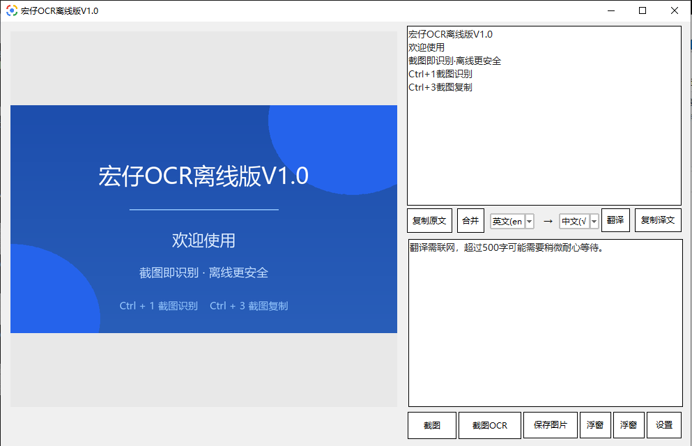

# 宏仔OCR离线版V1.0

> 宏仔OCR离线版V1.0 —— 纯离线文字识别 + 翻译工具（Windows）

离线屏幕截图 OCR 与翻译工具，适用于 Windows。识别无需联网，不上传数据，完全私密。

  

---
## 📥 快速下载

[](https://github.com/qhongzi/hongzi-ocr/releases/download/v1.0/hongzi-ocr-setup.exe) [](https://github.com/qhongzi/hongzi-ocr/releases/download/v1.0/hongzi-ocr-single.exe) [](https://github.com/qhongzi/hongzi-ocr/releases/download/v1.0/hongzi-ocr-green.zip)


## 目录

- [快速下载](#快速下载)
- [软件简介](#软件简介)
- [功能特性](#功能特性)
- [下载安装](#下载安装)
- [使用教程](#使用教程)
- [工作原理（技术实现）](#工作原理技术实现)
- [常见问题 FAQ](#常见问题-faq)
- [版权与联系](#版权与联系)

---

## 软件简介

宏仔OCR离线版V1.0 是一款**完全离线运行**的 Windows 文字识别（OCR）与翻译工具。按下快捷键框选屏幕任意区域，即可瞬间识别图中文字并自动翻译，无需联网、不上传任何数据，隐私绝对安全。界面清爽，操作方式和微信 OCR 一样顺手。

**一句话**：截图 → 识别文字 → 翻译 → 复制，全程本地完成。

## 功能特性

- ✅ **100% 离线 OCR**：内置 PP-OCRv4 中文识别模型，识别过程完全在本机运行，断网可用，数据不出电脑
- ✅ **截图即识别**：全局快捷键 `Ctrl + 1`，任意界面框选截图，自动识别文字
- ✅ **截图复制**：全局快捷键 `Ctrl + 3`，截图内容直接复制到剪贴板（`Ctrl + V` 即贴）
- ✅ **中英互译**：英文 → 中文使用内置离线词典翻译；其他语种自动走在线翻译兜底
- ✅ **三种截图后模式**：直接进入主窗口显示 / 无提示静默保存（打开主窗口可看）/ 弹出浮窗显示，互斥勾选
- ✅ **浮窗置顶**：识别/翻译浮窗支持置顶开关（苹果风格圆点：蓝=置顶，红=关闭），默认置顶
- ✅ **窗口自由拉伸**：主窗口、浮窗均可拖拽边缘自由放大缩小
- ✅ **开机自启**：默认开机静默启动驻留托盘，不打扰；exe 移动后自动更新启动路径
- ✅ **托盘驻留**：缩小到任务栏/托盘，随时唤醒
- ✅ **单实例**：重复打开自动唤醒已有窗口
- ✅ **图片拖拽**：支持直接把图片文件拖进窗口识别
- ✅ **绿色免安装**：单文件绿色版，解压即用

## 下载安装

### 系统要求

| 项目 | 要求 |
| --- | --- |
| 操作系统 | Windows 7 / 10 / 11（64位） |
| 内存 | ≥ 2GB（推荐 4GB） |
| 磁盘空间 | 约 300MB |
| 网络 | 识别与中英翻译无需网络；其他语种翻译需联网 |

### 安装步骤

1. 下载 `宏仔OCR离线版V1.0.zip`
2. 解压到任意目录（建议放非系统盘，如 `D:\宏仔OCR离线版V1.0\`）
3. 双击 `宏仔OCR离线版V1.0.exe` 即可运行
4. （可选）软件默认已开启开机自启，静默驻留托盘

> 💡 若杀毒软件误报，请添加信任或白名单（PyInstaller 打包的程序常见误报，属正常现象）。

## 使用教程

### 1. 首次启动

启动后出现主窗口，右下角任务栏出现托盘图标。默认开启开机自启，重启电脑后软件会在后台静默运行，点击托盘图标即可唤出。

### 2. 截图识别文字（OCR）

**方法一：快捷键**
1. 在任意界面按下全局快捷键 `Ctrl + 1`
2. 鼠标框选要识别的区域
3. 松开鼠标，自动识别文字并翻译

**方法二：点击"截图"按钮**
在主窗口点击"截图"按钮，同样框选识别。

### 3. 截图复制（不带识别）

按下 `Ctrl + 3`，框选区域后截图直接进入剪贴板，到任意位置 `Ctrl + V` 粘贴即可。

### 4. 翻译功能

- 主窗口内：粘贴/输入文字后点击"翻译"按钮
- 截图 OCR 后自动翻译（英文 → 中文）
- 翻译结果可复制、可发送到浮窗

### 5. 三种截图后模式（设置 → 截图方式）

| 选项 | 行为 |
| --- | --- |
| 直接进入主窗口显示结果（当前默认） | 截图识别后自动回到主窗口展示结果 |
| 无提示，结果保存在主窗口 | 截图后无任何提示，打开主窗口即可查看结果 |
| 弹出浮窗显示结果 | 截图后弹出置顶浮窗直接显示 |

三个选项互斥，勾选即生效。

### 6. 浮窗操作

- **置顶**：点击浮窗右上角**蓝色圆点**，置顶开（蓝）/ 关（灰）
- **关闭**：点击**红色圆点**关闭浮窗
- **拉伸**：拖拽浮窗边缘可调整大小
- **拖动**：按住浮窗标题区拖动位置，位置自动记忆，下次打开回到原处

### 7. 设置项

- **开机自启**：勾选后开机静默启动驻留托盘
- **截图同时复制到剪贴板**：识别结果自动复制（`Ctrl + V` 即贴）
- **快捷键**：可自定义截图、截图OCR 的全局快捷键（支持单键或组合键）

### 8. 托盘图标

- 左键单击：显示/隐藏主窗口
- 右键菜单：显示主窗口 / 设置 / 退出

## 工作原理（技术实现）

### 文字识别（OCR）

```
框选截图 → 裁剪屏幕图像 → RapidOCR 引擎 → 输出带坐标的文本行
```

- **引擎**：[RapidOCR](https://github.com/RapidAI/RapidOCR)（onnxruntime 推理）
- **模型**：PaddleOCR PP-OCRv4 中文模型
  - 文本检测：`ch_PP-OCRv4_det_mobile.onnx`
  - 文字识别：`ch_PP-OCRv4_rec_mobile.onnx`
- **推理框架**：ONNXRuntime，模型量化压缩，识别速度快、占用低
- 所有模型内置于软件，**推理全程本机 CPU 完成，无任何网络请求**

### 翻译

- **英文 → 中文**：内置离线词典 `dict_en_zh.py`（本地词库直查 + 智能分词/断句），断网可用
- **其他语种**：自动使用在线翻译接口兜底（MyMemory / Google Translate）

### 全局快捷键

通过 Windows API `RegisterHotKey` 注册系统级热键，即使软件在后台/托盘，也能全局响应 `Ctrl + 1`、`Ctrl + 3`。

### 开机自启

- 写入注册表 `HKCU\...\Run` 实现开机启动
- 每次启动自动校验注册表中的 exe 路径，若文件被移动则自动更新为新路径
- 默认以静默模式启动（`--hidden`），只驻留托盘不弹主窗口

### 技术栈

| 组件 | 用途 |
| --- | --- |
| Python 3.8 | 开发语言 |
| Tkinter / tkinterdnd2 | 界面 + 拖拽 |
| RapidOCR + onnxruntime | 离线文字识别 |
| OpenCV (Pillow) | 图像处理 |
| PyInstaller | 打包为 exe |


## 常见问题 FAQ

**Q：识别需要联网吗？**
A：不需要。文字识别 100% 本地运行，断网可用。

**Q：翻译需要联网吗？**
A：英文 → 中文使用内置离线词典，断网可用；其他语种翻译需要联网（使用免费在线接口）。

**Q：软件会泄露我的数据吗？**
A：不会。识别过程全程本地，不上传任何截图或文字。仅"其他语种翻译"场景会发送待翻译文字到第三方翻译接口。

**Q：提示杀毒/误报怎么办？**
A：PyInstaller 打包的程序容易被部分杀软误报，添加信任/白名单即可，源码开放可自行核对。

**Q：开机自启没生效？**
A：检查注册表项是否被安全软件拦截；或重新打开一次软件（会自动修复注册表路径）。

**Q：exe 被移动后开机自启失效？**
A：不会。软件每次启动会自动检查注册表路径，exe 移动后自动更新，无需重新设置。

**Q：双击 exe 又打开了一个新窗口？**
A：软件为单实例设计，重复启动只会唤醒已有窗口，不会重复运行。


## 版权与联系

- **作者**：宏仔
- **邮箱**：810331109@qq.com
- **版权**：Copyright © 2026 宏仔

本软件仅供学习与个人使用，欢迎提出宝贵建议。
